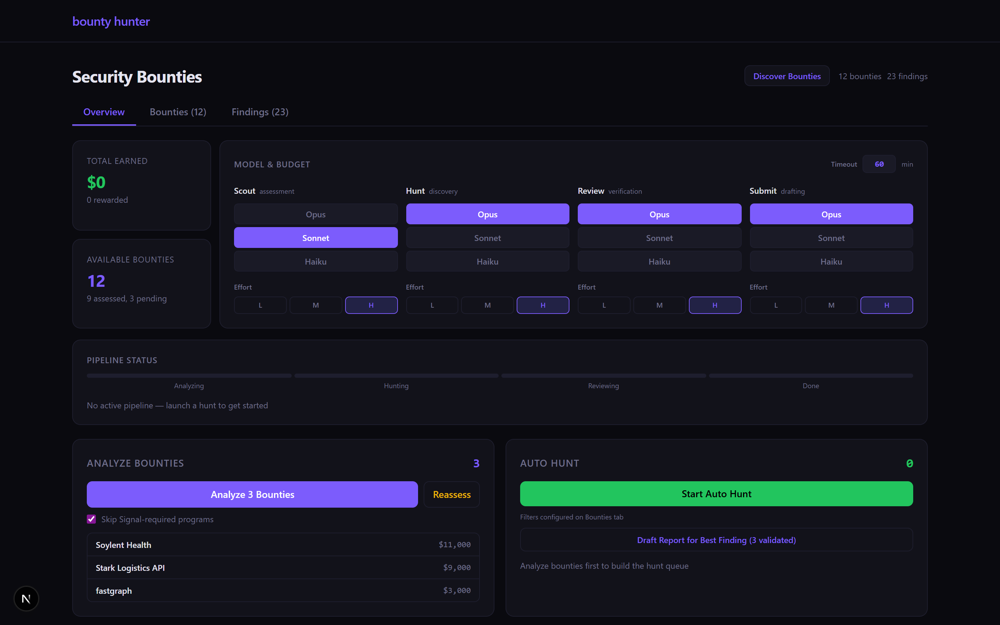
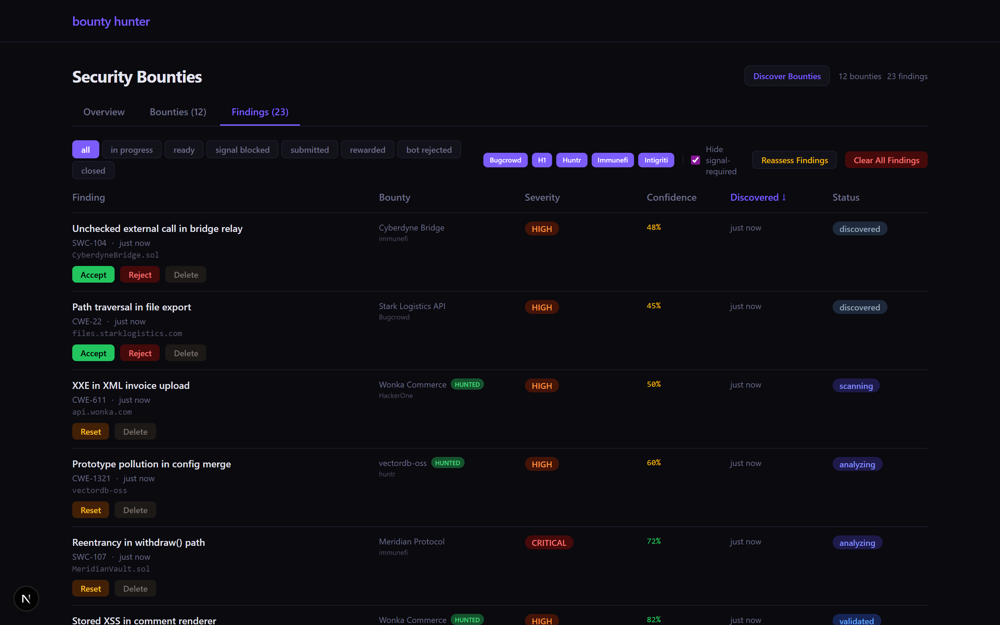

# autohack

**Operational status (2026-10-18):** The local model and complete live bounty workflow are **not yet verified end-to-end**. See [operator setup, verified cash accounting, safety controls and acceptance gates](docs/OPERATOR_RUNBOOK.md) and [readiness evidence](AUTONOMOUS_READINESS.md). The CI fixture only tests an owned synthetic target with an intercepted submission backend; it is not live-provider proof.

autohack is an autonomous security researcher for authorized bug bounty programs. It discovers programs, runs Claude sessions to hunt for vulnerabilities inside each program's declared scope, checks its own findings with a second adversarial model, drafts platform-ready reports, and submits behind a human approval gate.





<sub>The real-time tRPC dashboard. Top: the per-stage model control (Scout / Hunt / Review / Submit, each assignable to Opus, Sonnet, or Haiku) and the live pipeline. Bottom: findings moving through their lifecycle with per-finding confidence and status. <b>Shown with sample data.</b></sub>

## How it works

- Discovery polls HackerOne, Immunefi, and Huntr directly, plus an aggregator feed that adds Bugcrowd, Intigriti, YesWeHack, and Federacy. It deduplicates targets and scores each program for opportunity.
- Each hunt spawns Claude in a pseudo-terminal for a 60-minute session scoped to one program's rules. Every tool call streams live to the dashboard over xterm.js.
- A second Claude instance reviews each finding as an adversary, scoring it 0-15 across five dimensions (exploitability, impact, evidence, novelty, scope fit). Anything under 8/15 is rejected before it becomes a report.
- Approved findings get a platform-formatted report with reproduction steps, impact, and remediation, then a separate Sonnet pass trims verbose ones. Submission runs through a manual approval gate; auto-submit is off by default and only applies to findings the reviewer marks "submit".
- Every hunt writes findings, near-misses, and dead ends to a store, so later hunts on the same program start with that history and skip known dead ends.
- Each stage (Scout, Hunt, Review, Submit) runs on Opus, Sonnet, or Haiku, set live from the dashboard. Ephemeral prompt caching cuts repeated input tokens about 90%. Two backends: Claude Max via CLI, or the API via SDK (`CLAUDE_BACKEND=cli|api`).

Built on direct Anthropic SDK calls, no framework wrappers. TypeScript, Next.js 15, tRPC, SQLite with Drizzle, xterm.js, Pino, node-cron.

## Running locally

```bash
npm install
cp .env.example .env    # add your Claude backend and platform tokens
npm run dev             # orchestrator + dashboard on :3456
npm run dashboard       # dashboard only, on :3456
```

## Scope

autohack only hunts targets with active, in-scope bug bounty programs, and never touches systems without authorization. The prompt scaffolding and per-program cheat sheet bound each session to that program's declared scope. Nothing is submitted without passing the approval gate unless auto-submit is explicitly turned on.


### Local source inspection settings

Local source inspection defaults to 180 minutes and 2,048 generated tokens per response.
`LOCAL_HUNT_NUM_PREDICT` accepts 32–4,096; truncated JSON may retry up to 4,096
when context permits. The context remains 8,192 tokens and generation stays sequential.
These are local Ollama settings; they do not select a paid service. Existing environment
or persisted timeout overrides remain in effect. The dashboard timeout now edits the
source-inspection budget when a local model is active.

Run `bash scripts/install-reproduction-runtime.sh` with Node 22 selected to install/check
Python, Node, the Solidity compiler/local EVM, bubblewrap and a Java JDK. Java probes
support public static `Class.method(String)` returning `String`, with JDK or repository
source dependencies. They compile inside the offline sandbox with annotation processing
disabled; Maven/Gradle builds and third-party Java dependencies are not supported.
JavaScript supports exported functions (including async). Solidity uses the installed
0.8.30 compiler and supports the existing string probes and declarative transaction tests.
Source readers and searches work independently of whether a supported test can run.


### Diagnose local controller behavior

`node --import tsx scripts/test-local-controller.ts` uses the configured local Ollama
model at the hunt's 8,192-token context and configured output allowance. It asks the
model to read an owned Python fixture, select its isolated probe, and finish after
observing the result. It saves timing, turn counts and a transcript under
`data/controller-diagnostics/`. It does not query bounty programs or submit reports.
Run it with the service stopped so the measurement is not competing with a hunt.
The default deadline is ten minutes, configurable with `LOCAL_AGENT_TEST_TIMEOUT_MS`.
A fixture pass tests basic tool sequencing, not autonomous performance on large repositories.

Program assessments already persist in the local SQLite database, inside
`security_programs.scope_summary.assessment`. Automatic analysis skips saved scores;
startup does not intentionally clear them. The dashboard's explicit Reassess operation
can clear assessments. If analysis repeats after a restart, compare the configured
DB_PATH and persisted assessment counts before changing storage or adding cloud backups.

### Progress-aware local investigations

Local source investigations start with `LOCAL_HUNT_MAX_TURNS` (default 80) and
`SECURITY_SOURCE_CODE_TIMEOUT_MINUTES` (default 180). With
`LOCAL_HUNT_DYNAMIC_ALLOWANCE` enabled (default), approaching either limit can
add 40 turns and 60 minutes together. An extension requires at least ten turns
with newly delivered source ranges or distinct completed probes within the last
20 turns, including progress within the last three turns. Repeated/overlapping
reads, directory navigation, errors and model assertions do not earn credit.
Credits are consumed by the extension. A run remains bounded at 640 turns and
24 hours (or the original deadline if configured longer); individual model
requests have a maximum 15-minute deadline. Set
`LOCAL_HUNT_DYNAMIC_ALLOWANCE=false` to restore fixed allowances. Operator
cancellation remains immediate, and the daily dispatch setting is unchanged.

Each local audit writes `.log.summary.json` beside its existing log, including
read ranges, completed distinct probes, final answer, stopping reason, elapsed
turns and final allowance. `[ALLOWANCE_EXTENDED]` records why an extension was
earned. `[MODEL_ACTION]` records the selected action, including empty finals;
empty finals get two corrective retries and never become successful outcomes.
The dashboard displays partial inspection separately from “no findings,” with
the recorded coverage explanation. This includes matching recent older records
when their persisted coverage timestamp identifies the same attempt.

Source hints prioritize application code over configuration, vendor fixtures,
and deployment/test scripts without excluding those files. Solidity hints use
the existing outline/function-context tools before paginating whole files.
Context size, output budget, thread count, source evidence requirements and
probe/report validation remain unchanged.
